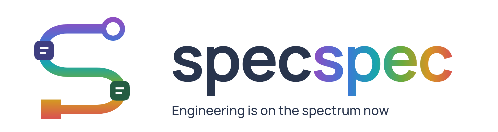
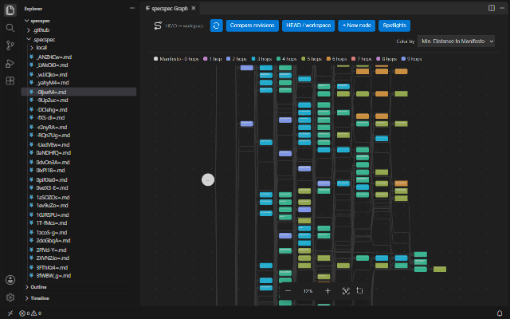
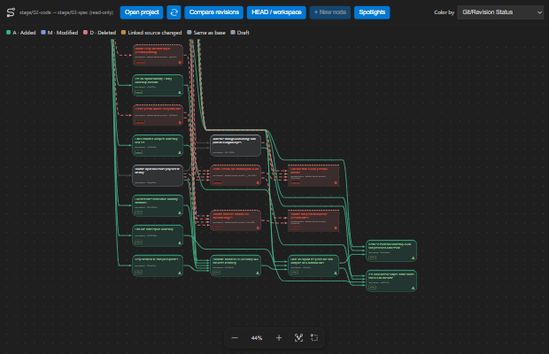
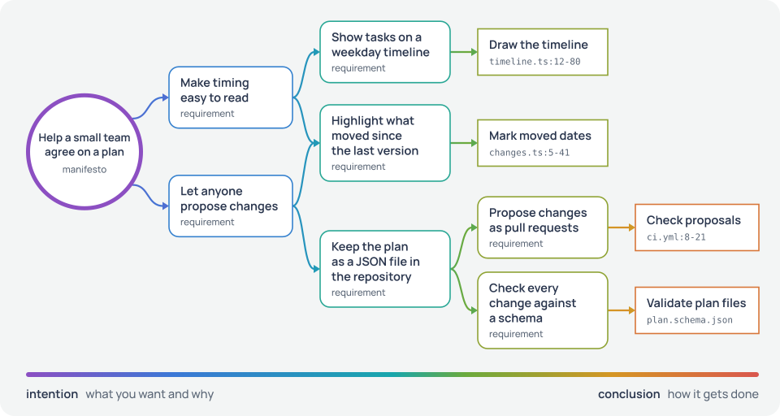
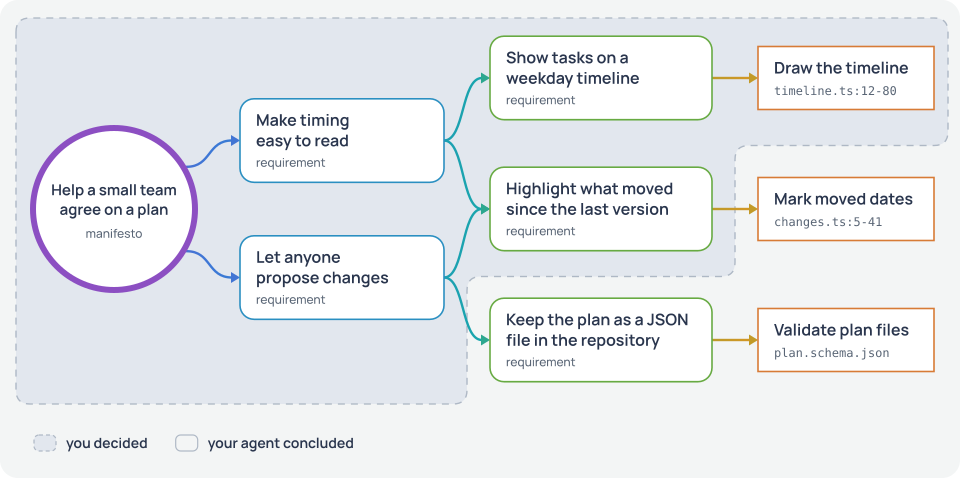
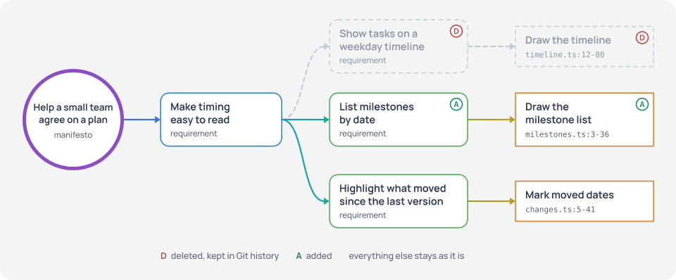
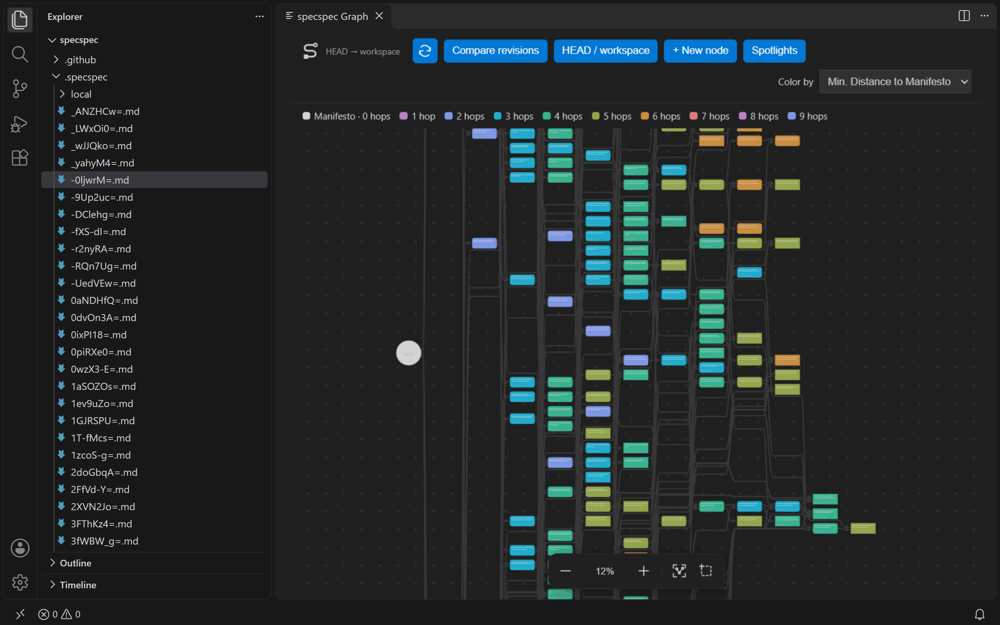
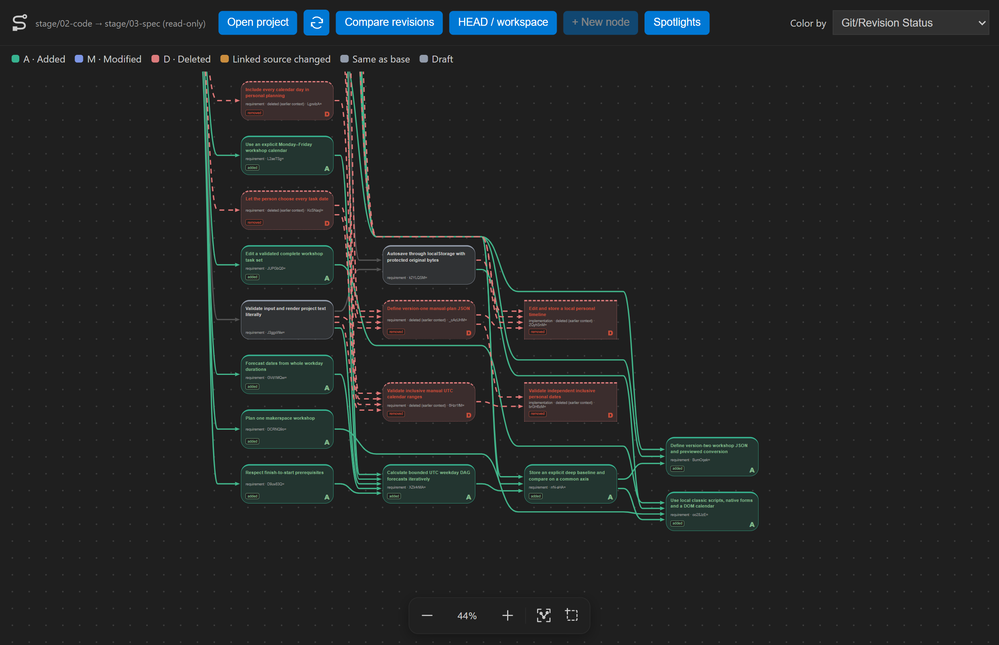

<picture>
  <source media="(prefers-color-scheme: dark)" srcset="https://raw.githubusercontent.com/jejay/specspec/main/branding/specspec-logo-tagline-dark.png">
  
</picture>

specspec connects your intentions to revisable decisions and to the code that realizes
them, so you can choose how much to direct or delegate at every step. The specification
is a graph of Markdown files in your Git repository. You read and edit it in a visual
graph editor, and your coding agent works on it through a command-line tool.

The name is short for *specification spectrum*.

<a href="#what-you-work-with-the-graph-in-vs-code-and-in-a-desktop-app"></a>
<a href="#what-you-work-with-the-graph-in-vs-code-and-in-a-desktop-app"></a>

- [Quick start](#quick-start)
- The idea: [the problem](#the-problem-your-intent-and-the-agents-suggestions-merge-into-one-plan),
  [the graph](#the-specification-is-a-graph-from-intention-to-conclusion),
  [your depth](#you-choose-how-deep-you-go-in-each-part-of-the-graph),
  [replacing a conclusion](#replacing-a-conclusion-keeps-the-intention-it-was-drawn-from)
- In practice: [the editors](#what-you-work-with-the-graph-in-vs-code-and-in-a-desktop-app),
  [working with your agent](#how-you-and-your-agent-work-on-the-graph),
  [building the editors](#build-the-graph-editors),
  [the command line](#the-command-line-your-agent-uses)
- [Example](#example-a-planning-app-that-changed-direction-twice),
  [status and limits](#status-and-limits), [guides](#guides)

## Quick start

You need Python 3.11+ and Git. Install the command-line tool, which your agent and the
graph editors run, from [PyPI](https://pypi.org/project/specspec/) and describe your
project in a sentence or two:

```sh
uv tool install specspec    # or: pipx install specspec
cd your-project
specspec init -m "# Help a small team agree on a plan" -m "Everyone sees the same dates and why they moved."
```

Then start your coding agent in the project and tell it what you want, as you would
anyway. Any agent that can run shell commands works. `init` wrote an `AGENTS.md` that
teaches it the rest: it plans in the graph before it builds, records the conclusions it
draws for you, keeps graph and code in sync and reports what it decided and what is
uncertain. `init` also sets up Git if the folder has none and appends to an `AGENTS.md`
you already have. If your agent reads a different instructions file, point it to
`AGENTS.md`.

You can leave it at that. When you want more control, open the graph in
[a graph editor](#build-the-graph-editors): look at it from as far above as you like,
open the nodes the agent pointed you to, change a node or replace a conclusion, and
tell the agent to carry on. The rest of this page explains what you are looking at.

## The problem: your intent and the agent's suggestions merge into one plan

When you build with a coding agent, much of the specification gets written in
conversation. You describe a goal, the agent proposes a way to reach it, you agree,
and it builds. A few rounds later, what you wanted and what the agent suggested have
merged into one plan. Some details are there because you need them, others because
they were the first idea that worked, and the plan reads the same either way.

That matters once you want to try something else. With an agent, rebuilding the data
model or the UI takes minutes. The hard part is knowing what the old one was for, so
that the new one keeps it.

It also decides how closely you can follow the work. A plan that mixes goals with
details has no good place to stop reading: you go through all of it or you take it on
trust. Most projects need something in between, close attention to a few parts and a
rough idea of the rest.

specspec keeps the plan in the repository as a graph, next to the code, ordered from
what you want to how it gets done.

## The specification is a graph from intention to conclusion

<picture>
  <source media="(prefers-color-scheme: dark)" srcset="https://raw.githubusercontent.com/jejay/specspec/main/docs/images/spectrum-dark.svg">
  
</picture>

Every node is a short Markdown file in `.specspec/`. The root is the *manifesto*: what
the project is for. Every other node names its parents and is a *conclusion* drawn from
them: it refines them or settles a way to achieve them. The parents are the node's
*intentions*. *Implementation* nodes at the outer edge explain how the code realizes a
requirement and link to the files and line ranges involved.

Intention and conclusion are the two ends of a link, not two kinds of node. "Make timing
easy to read" is a conclusion from the manifesto, and it is the intention behind "Show
tasks on a weekday timeline". Every node between the manifesto and the code is both.
Near the manifesto a node is mostly intention: what you want and why, with much hanging
on it. Further out it is mostly conclusion: how it gets done. That range is the
spectrum, and a node's place on it follows from its position in the graph. Branches go
as deep as they need to.

A conclusion is one valid conclusion. It rests on reasoning, some of it written in the
node and some of it not, and a different one could be drawn from the same intentions.
That holds at every depth, also for what you want: when your goals move, you change a
node near the root. How firmly a node holds is yours to know, and the graph has no mark
for it. For a Python library the language belongs in the manifesto. For an app where you
have no preference, it is a conclusion far down that your agent draws.

One conclusion can serve several intentions, which makes the graph a directed acyclic
graph rather than a tree. In the file, that is simply a second parent:

```markdown
---
id: OHYE-rI=
type: requirement
parents:
- rrvyriU=
- ABOH2aU=
---
# Highlight what moved since the last version

Compare the plan with the previous commit and mark changed dates.
```

## You choose how deep you go in each part of the graph

The graph runs from intention to conclusion, so every depth is a place where you can
stop. You can write only the manifesto and let the agent draw everything below it. You
can pin one branch down conclusion by conclusion, as far as the code. Reading works the
same way: skim the top two levels of what the agent drew, or follow one branch node by
node until you understand every step in it. Past the point where you stop, the agent
concludes on its own and records its conclusions as nodes like any other.

<picture>
  <source media="(prefers-color-scheme: dark)" srcset="https://raw.githubusercontent.com/jejay/specspec/main/docs/images/direct-dark.svg">
  
</picture>

In this example you started with the goal and the two things the team wants, and the
agent drew the rest. Later the timeline turned out to matter, so you took that branch
over, down to the code, and decided yourself that moved dates get highlighted. How
proposals work is still the agent's part: a JSON file in the repository, pull requests
and a schema check. You have never read that branch closely, and it is there whenever
you want to.

The tagline, *Engineering is on the spectrum now*, refers to this range. At one end is
hands-on engineering, where you make every decision yourself. At the other is vibe
coding, where the agent makes them for you. With specspec you pick a point on it for
each part of a project and move it as the project goes on: go deep where something
surprised you, and step back where things have settled.

The graph editors are made for this. Zoomed out, you see the whole graph, colored by
distance from the manifesto if you like. Zoom into one branch and select a node, and
you read its text with its parents and children around it. The shaded areas in the
figure are yours alone; the graph holds the nodes on both sides of them.

## Replacing a conclusion keeps the intention it was drawn from

Every conclusion has a node of its own beneath its intention, and that keeps solutions
revisable. "Show tasks on a weekday timeline" is one way to make timing easy to read. If
a list of milestones works better, you replace that branch. The intention above it
stays, the new conclusion is written to serve it, and the conclusion next to it is
untouched.

<picture>
  <source media="(prefers-color-scheme: dark)" srcset="https://raw.githubusercontent.com/jejay/specspec/main/docs/images/revise-dark.svg">
  
</picture>

The same works one level up. If timing turns out not to be the point, you replace "Make
timing easy to read". The manifesto stays, and your agent goes through everything that
hung beneath the old node. Replacing a node always leaves what is above it in force and
puts what is beneath it up for review.

## What you work with: the graph in VS Code and in a desktop app

As the owner you read and edit the graph in a graph editor: the VS Code extension or
the desktop app, which draw the same zoomable canvas.



This is specspec's own graph in VS Code from far above: about 280 nodes, colored by
their distance from the manifesto. The node files are in the Explorer on the left.



The desktop app, closer in, compares two stages of the
[example planner](#example-a-planning-app-that-changed-direction-twice): nodes marked D
were deleted by the redirect, nodes marked A were added, and the gray ones stayed.
Selecting a node opens its text, parents and sources for editing.

## How you and your agent work on the graph

The guide in `AGENTS.md` sets out how the agent works with you:

1. You describe what you want. The agent first tells your intentions from the
   conclusions you have already drawn and says how it read you. It asks when it cannot
   tell whether something is fixed for you. It holds each conclusion against its
   intention, objects where one does not fit, also right beneath the manifesto, and
   suggests its own. The graph stays as it is while you talk. Skip this step when the
   request is clear.
2. When you ask for it, the agent writes the graph through the command line, building
   on any edits you made yourself. It completes the depth that building needs, fills
   gaps you evidently left to it and reports the intentions it read into your words, the
   conclusions it drew itself and its open questions. Whenever it talks about particular
   nodes, it leaves a *spotlight* on them, so the editor shows you which ones it means.
   Your edits and its changes go into two separate commits.
3. You review as much of it as you want in a graph editor. It marks nodes added,
   changed or deleted since the last commit and shows each change inside the node's
   text. Edit any node there, or select a few nodes and leave the agent a spotlight of
   your own. When you have edited nodes, the agent first tells you what it would split,
   move or reword, and whatever you do not accept stays as you wrote it.
4. The agent implements, after planning whatever the graph does not cover yet. Before
   it changes code, it reads the node and every ancestor that justifies it. It keeps
   graph and code in sync: what it settles on the way becomes further conclusions, and
   implementation nodes link to the code. When it finds a contradiction, it builds a
   consistent part and reports the rest.
5. When you change your mind, you replace the node, at whatever depth, and the agent
   looks again at what hangs beneath it. The graph describes the current plan; Git keeps
   the earlier ones and the reasons they changed.

The goal is a graph precise enough that implementing it comes close to compiling it,
with little left for the agent to guess. Look hard where uncertainty and impact are
high, and decide when the graph is clear enough to be worth an implementation attempt.
Each attempt is evidence for the next revision. The
[agent guide](https://github.com/jejay/specspec/blob/main/src/specspec/templates/AGENTS.md)
is the file `init` adds.

## Build the graph editors

For now you build both editors from this repository, which needs Node 22.12+ and npm
10+. Both run the `specspec` command you installed.

```sh
git clone https://github.com/jejay/specspec.git
cd specspec
npm ci
npm run package:vscode    # then: code --install-extension dist/specspec-vscode-0.0.1.vsix
npm run desktop           # or start the desktop app from source
```

In VS Code, run **specspec: Open Graph** from the Command Palette. The desktop app runs
on Windows and Linux; on macOS, use VS Code. The
[editor guide](https://github.com/jejay/specspec/blob/main/vscode/README.md) covers the canvas, reviewing changes,
spotlights and settings.

## The command line your agent uses

Your agent works through the `specspec` command, and both editors run it for every read
and write. You can use it yourself. `init` prints the manifesto's ID, such as
`TZ971GA=`; IDs end in `=`, so copy them whole.

```sh
specspec query --max-distance 2                      # the top of the graph
specspec query ID --max-distance 0 --with-ancestors  # one node and everything that justifies it
specspec add --parent ID -m "# Make timing easy to read" -m "Everyone sees when each task happens."
specspec update ID --replace "old wording" "new wording"
specspec delete ID
specspec diff                                        # changes since the last commit
specspec check                                       # structural validation
```

Every command has `--help` with examples. If `specspec` isn't found, run
`uv tool update-shell` (or `pipx ensurepath`) and open a new terminal; upgrade with
`uv tool upgrade specspec`.

## Example: a planning app that changed direction twice

[`example/gantt`](https://github.com/jejay/specspec/blob/main/example/gantt/README.md)
is a small planning app built with specspec, with its own Git history. It changed
direction twice: from a portfolio tool for business projects, to a personal planner
with hand-picked dates, to a workshop planner that forecasts finish dates. Each
redirect deleted the conclusions that no longer applied and kept the intentions that
still did. From this repository, with the CLI installed:

```sh
python example/gantt/history/checkout.py    # clones it to ~/Projects/specspec-examples/gantt
```

Open the clone in either editor and compare `stage/01-code` with `stage/02-spec`, or
run `specspec diff stage/01-code stage/02-spec` inside it.

## Status and limits

specspec 0.0.1 is the first public release. The CLI is on PyPI; the editors are built
locally. Expect rough edges and changing commands.

Everything runs on your machine. The graph is Markdown in your repository, and you
stage and commit it like any other file. `specspec check` confirms that the graph is
well formed: one manifesto, every node reachable from it, no cycles. Whether the
product does what the nodes describe is for you, your tests and your agent to judge.
Implementation nodes help by pointing at the exact code, and
`specspec check --sources` flags linked code that has changed or disappeared since it
was linked.

specspec is developed with specspec. Its own graph is in
[`.specspec/`](https://github.com/jejay/specspec/tree/main/.specspec), and
[CONTRIBUTING](https://github.com/jejay/specspec/blob/main/CONTRIBUTING.md) explains how to work on it.

## Guides

- [Agent guide](https://github.com/jejay/specspec/blob/main/src/specspec/templates/AGENTS.md): the routine and rules your agent follows
- [Editor guide](https://github.com/jejay/specspec/blob/main/vscode/README.md): the VS Code extension and the desktop app
- [Contributing](https://github.com/jejay/specspec/blob/main/CONTRIBUTING.md): development setup, checks and releases
- [Changelog](https://github.com/jejay/specspec/blob/main/CHANGELOG.md)

specspec is [MIT licensed](https://github.com/jejay/specspec/blob/main/LICENSE).
