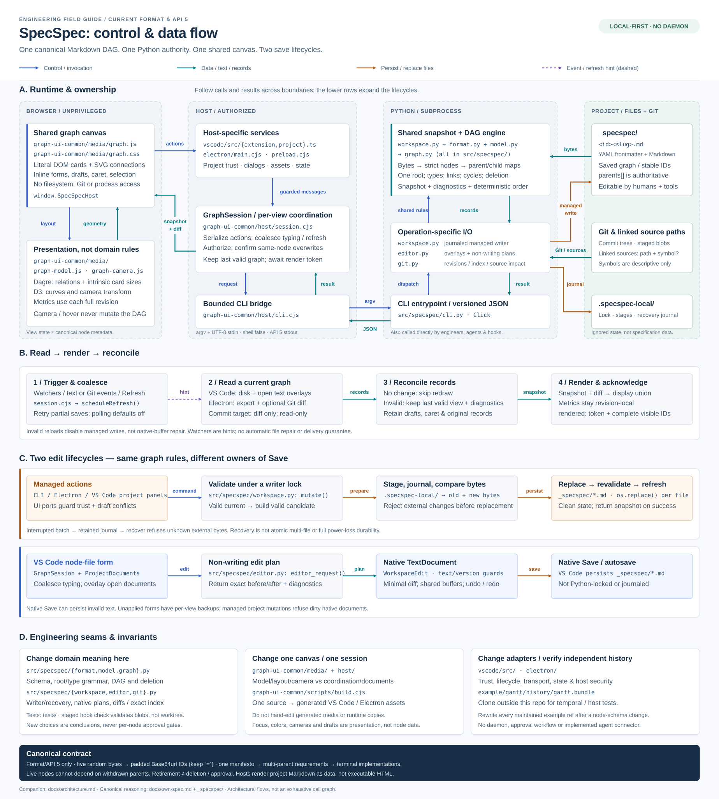

# Architecture: user and agent workflows

[Open the architecture SVG](architecture.svg) at full size. Read it top to bottom:
**01** follows the owner and agent into the tooling; **02** separates the two Save
owners; **03** follows agent work back to owner review. The live-feedback strip
connects file/document/Git changes to refreshed views. The source map below expands
these boundaries without putting every module into the overview.



This is descriptive documentation of the current implementation. The
[specification tour](own-spec.md) and tool-managed [`_specspec/`](../_specspec/)
graph explain binding intentions and revisable choices; Git retains earlier designs.
Arrows summarize named architectural flows, not every function call.

**Second diagram:** [CLI / Python library / UI interface zoom](architecture-interfaces.svg)
opens the message, subprocess and in-process boundaries, shows concrete payloads,
and traces a native form edit. It also shows how an agent bypasses the UI to use
that same CLI contract, or imports the library into its own Python process.

## The mental model

- **Canonical data is a Markdown DAG, not a database.** Each direct
  `_specspec/<id><slug>.md` file has strict YAML frontmatter and a binding body.
  `parents` stores incoming links; the graph has one manifesto, requirements with
  potentially multiple parents, and terminal implementations. Only shortcut-free node format 6, API 6
  and padded five-byte Base64url IDs, including the final `=`, are supported.
- **Python owns domain meaning.** Schema, graph rules, physical deletion, Markdown plans,
  managed transactions and Git comparisons are shared by the CLI and both UIs.
  No host reimplements those rules. Each request rebuilds current snapshots.
  Project-scoped API channels reuse interpreter lifetime; CLI commands and library
  callers use the same domain functions.
- **One shared UI has two persistence lifecycles.** Electron and VS Code project
  panels use Python-managed writes. VS Code node-file editors apply non-writing
  Python plans to native text documents. These saves are deliberately *not*
  Python transactions.
- **Presentation is not specification.** Cameras, focus, colors, layout and drafts
  do not enter canonical metadata. Graph depth is not confidence; withdraw by
  deleting node files, with reasons/earlier explanations in Git. Deleted HEAD nodes
  remain D through staging and disappear after commit; no retired status exists. Agent context is implemented as CLI
  exports; Claude Code/Codex connectors are not implemented.

## How the owner and agent use the tooling

| Entry point | Workflow and interface |
| --- | --- |
| Owner in VS Code | Open a canonical node file for a native graph/text-document editor; use **Open Graph** for project actions or **Compare Revisions** for independent comparisons. Browse relationships, edit forms, inspect source previews and review Git differences. |
| Owner in Electron | **Trust and Open** a local project, then use the same canvas, forms and comparisons. Saves use Python-managed commands rather than VS Code documents. |
| Agent in its own harness | Invoke `specspec query` from the shell (readable by default, explicit `--json` for structured processing), or use the Python library. Complete selected readings with `--with-ancestors` and inspect dependents, deepen conclusions, link implementation sources and validate changes. People can use this CLI too. |
| Direct Markdown and Git | Manual node edits are allowed. Ordinary editor/Git tools own raw text, staging, commits and branch selection. SpecSpec supplies graph-aware diagnostics, diffs and opt-in exact-index checks. |

The **owner–agent conversation is outside SpecSpec**. The current product does not
embed an agent or provide a Claude Code/Codex connector. `AGENTS.md` describes the
working process, not an orchestration service. Requested planning and implementation
use the same tools as other CLI clients; meaningful choices remain revisable.

A typical agent loop is:

1. Inspect owner edits and the working/index state before acting; read the selected
   node and its complete ancestor context with
   `query <id> --max-distance 0 --with-ancestors`. Rooted query limits help orient;
   `diff` provides exact specification changes and ordinary Git provides code patches.
2. Use `show <id> --dependents --json` and `diff <ref> --json` to understand dependencies
   and changes. Discuss consequential scope changes with the owner; use `add`/`update`
   for requested graph refinement and preview destructive `delete` operations.
3. Implement under those intentions, keep implementation explanations and `sources`
   current, then run graph validation and the relevant code tests.
4. Return differences, evidence and material uncertainty to the owner. When a commit
   is authorized, stage deliberately and run `check --staged` (optionally `--sources`)
   against that exact index before committing through ordinary Git tooling.

**The CLI reads saved files, not VS Code's unsaved buffers.** Working VS Code views
also use open-document overlays; an agent must coordinate with those documents'
save owner rather than assume a CLI read includes pending form/raw-text edits.
Direct CLI/library calls do not run UI confirmation queues, the UI's per-node draft
checks or VS Code dirty-document guards. Their caller supplies process controls and
coordinates with open documents; Python still enforces domain and managed-writer rules.

## A. Follow the runtime boundaries

| Layer | Start reading here | Responsibility |
| --- | --- | --- |
| Browser canvas | [`graph.js`](../graph-ui-common/media/graph.js), [`graph-annotations.js`](../graph-ui-common/media/graph-annotations.js), [`graph-model.js`](../graph-ui-common/media/graph-model.js), [`graph-camera.js`](../graph-ui-common/media/graph-camera.js), [`view.cjs`](../graph-ui-common/view.cjs) | Literal DOM text/native forms, SVG curves, revision overlays, metrics, Dagre layout and D3 navigation. Calls `window.SpecSpecHost`; cannot access project files or spawn tools. |
| Shared host coordination | [`session.cjs`](../graph-ui-common/host/session.cjs), [`documents.cjs`](../graph-ui-common/host/documents.cjs), [`cli.cjs`](../graph-ui-common/host/cli.cjs), [`client.cjs`](../graph-ui-common/host/client.cjs) | Per-view `GraphSession`, project-level `ProjectDocuments`, serialized mutations, independent read-only previews, conflict guards, render handshakes and bounded project-scoped API channels. No VS Code/Electron SDK imports. |
| Host adapters | [`vscode/src/extension.ts`](../vscode/src/extension.ts), [`electron/main.cjs`](../electron/main.cjs), [`electron/preload.cjs`](../electron/preload.cjs) | Trust, project discovery, dialogs, file/Git notifications, assets, messaging and presentation storage; VS Code also supplies native documents. |
| Python backend | [`cli.py`](../src/specspec/cli.py), [`workspace.py`](../src/specspec/workspace.py), [`format.py`](../src/specspec/format.py), [`model.py`](../src/specspec/model.py), [`graph.py`](../src/specspec/graph.py) | Click dispatch, byte snapshots, version bootstrap, strict schema/round-trip YAML, normalized records, adjacency maps, deterministic ordering and iterative traversals. |
| Operation-specific I/O | [`editor.py`](../src/specspec/editor.py), [`git.py`](../src/specspec/git.py), [`workspace.py`](../src/specspec/workspace.py) | Unsaved overlays/edit plans, Git snapshots/diffs/source impact, and lock/stage/journal/recovery respectively. All reuse the snapshot/schema/graph engine. |

The bridge spawns the trusted executable with argument arrays, `--root`, and
`shell: false`. Bodies or editor requests go through UTF-8 stdin. JSON stdout has
`{api_version: 6, ok, result, diagnostics}`; process time and output are bounded.
Ordinary CLI exits are 0 for success, 1 for invalid/rejected operations, and 2 for invocation
or I/O failures. Invocation failures can lack JSON; the host also handles stderr,
malformed stdout, timeouts and output limits. Bridge defaults are 120 seconds and
16 MiB combined stdout/stderr, not limits imposed on an agent's own subprocess tool.
`api --stream` serves bounded newline-delimited requests with one ordinary envelope
per frame. Each project has a main API channel and an independent warmed source
channel. Requests retain fresh validation; channel failure rejects pending work and
a later request can start a new process. Mutations are never automatically replayed.
Closing/switching projects or changing executable configuration disposes channels.
An editor plan can succeed while reporting `snapshot.valid: false`: it preserves
repairable intermediate text, not a valid graph claim.

The CLI and library run in the **same Python process**. `cli.py` parses inputs,
calls module functions, converts results to dictionaries and emits the envelope.
Library clients instead receive Python types such as `Snapshot`/`Graph` or ordinary
result dictionaries and handle `SpecError` directly. For example, `load_snapshot()`
returns diagnostics and a `.valid` flag; `.require_valid()` raises for an unusable
graph. Library calls stay in-process; the host's API channels are project-scoped
child processes with bounded pipes.

`show`, `query`, `show ID --dependents` and `diff` are the compact read-side
entry points for engineers/agents. Text/Markdown is default; explicit `--json` selects
compact API 6. Query's `--with-ancestors` completes selected bindings through every
parent path and identifies omitted surrounding child/sibling IDs without their
bodies. The shared emitter formats once and applies an optional `--max-bytes` to
the actual UTF-8 result plus final newline, including envelopes/control escaping;
it fails rather than truncating. [`query`](query.md) reads complete revision comparisons
with spotlight-style HEAD/workspace defaults. Ordered iterative last-occurrence walks
print one selected-record overlay with current records/parents plus base-only deleted
records/former parents. No current node has a deleted parent, so this display is
acyclic even if the complete edge union is cyclic. It retains compact rails, full
parent headers, complete one-line body projections and deleted ghosts without
canonical revalidation. Single newlines become spaces; longer runs become ` ¶ `.
Types/statuses use lowercase words without a legend; root content aligns at column
zero. Parent IDs always use comma-space separators. Default sources share one
comma-separated metadata line per node; --human retains logical body lines and
individual source lines. This flag changes only rendering, including when combined
with --json. Original bodies remain exact in JSON and diff.
`query_select.py` batches rooted reachability, a shared forward distance pass and
reverse self-inclusive influence bitsets. Last-consumer release avoids retaining
closure rows on chains and leaf fans. Inclusive thresholds or exact ceil-percentage
quotas select each metric independently and union the resulting IDs. Full parent
metadata stays intact; the induced display and scoped API-6 comparison identify
boundary IDs. Optional ancestor completion uses one multi-source parent walk after
selection and before the final induced view/source work. JSON distinguishes matches
from additional ancestors, without changing the original quotas/population. Neighbor
IDs come only from matches, with each shared parent's children scanned once.
Complete unfiltered reads need no extra view. Original snapshots remain validated.
`query_sources.py` reuses one cached SourceReader per distinct code version and interprets strict/expanding/
path-only contracts: permitted changes stay quiet; known transitions drive source-changed and
ancestors in both original graphs. Broken/unknown mappings stay explicit. API-6 JSON
retains complete selected revision records, required raw source facts and separate
contract classifications. Source evidence includes old/new descendants of selected
nodes, keeping badges stable when an excluded owner affects a visible ancestor;
independent branches need no resolver reads. Multi-source walks propagate effects
once per original graph. Unfiltered queries retain both complete graphs;
shared conservative file-impact facts remain available. Known committed source blobs
are prefetched into the existing per-call cache in batches; no query cache crosses
invocations. Patches belong to `diff`. See [query profiling](investigations/query-performance.md).
[The command guide](cli.md) describes all eight everyday verbs.

The renderer uses local assets and a nonce-protected CSP, inserting project text
through `textContent`/`value`, never executable Markdown. Electron's
[`security.cjs`](../electron/security.cjs) restricts assets, actions and IPC senders;
its sandboxed/context-isolated preload exposes no general filesystem, process or
IPC API. VS Code requires workspace trust before invoking the tool.

## B. A read/refresh round trip

1. Host notifications call `scheduleRefresh()`. VS Code's reference-counted
   `GraphProject` watches canonical files and document changes. Both hosts share
   asynchronous HEAD/ref watching; index stat-cache/status churn leaves the
   HEAD-to-working presentation unchanged.
   Electron's [`GraphWatcher`](../graph-ui-common/host/watch.cjs) watches the project
   parent and node directory, reattaching after directory replacement. Events are
   hints, not a change log. The session coalesces bursts and retries transient reads;
   configurable polling defaults to **0/off**, and explicit Refresh remains.
2. Both hosts use `ProjectReads.readGraph()` → hidden `api`, `op: read` with an
   optional base/target. Electron supplies saved files; VS Code adds native document
   text through `ProjectDocuments`. Working-first startup is explicitly provisional;
   normal comparison refresh uses one request with bounded verified baseline hints.
   Historical targets use Git trees and ignore working buffers. A valid workspace
   remains usable with a **diff-unavailable** note when its baseline cannot be read.
   API 6 sends one target plus previous records only for differing/deleted nodes;
   the shared adapter reconstructs both complete revision graphs for rendering.
3. Identical automatic-refresh payloads do not redraw. Invalid reads preserve the
   last valid graph, explicitly mark it out of date, retain input and disable
   managed mutations. Bound native forms remain available for repair. No invalid
   external file is automatically rewritten.
4. The renderer combines base/target records and added/removed relationships for
   display. That union can contain cycles, so path metrics use each **complete
   individual revision**, never the union or focused subset. Dagre's placement
   backbone is only a layout aid: it does not remove canonical or displayed links.
   Intrinsic card sizes/relationships determine world layout; viewport/camera
   changes do not reflow the graph.
5. Startup waits for `ready`; a snapshot carries a `renderToken`. The renderer
   returns `rendered` with the token, visible IDs and count. `renderMatches()`
   checks complete overview/neighborhood membership. Timeouts/client failures
   become visible errors. These are sequence/membership checks, not content hashes.

Drafts retain original node records. An unrelated graph change does not invalidate
an edit; a managed same-node overwrite asks for confirmation, and a deleted draft
stays copyable instead of recreating the file. Cameras are per view/scene; split
native editors share text, not cameras.

## C. Two edit paths — do not collapse them

### Managed commands: CLI, Electron, VS Code project panels

UI sessions check authorization, current node IDs and draft conflicts, then build
specific CLI commands; renderers cannot supply arbitrary commands or file paths.
Direct CLI calls do not run the UI workflow; warned CLI deletion asks one terminal
confirmation or requires explicit `--yes` for JSON/noninteractive calls.

[`deletion.py`](../src/specspec/deletion.py) plans the full directed descendant
closure, including shared children, and derives per-node Git warnings without
optional index writes. Both hosts use `delete --dry-run --json`, show the total
scope/warnings, then pass a reviewed plan to the managed command. It recomputes
scope/paths/warnings under the lock and refuses changed scope rather than silently
deleting more nodes. This is destructive-action consent, not node review approval.
See [deletion](deletion.md) for warning, native-document and Git-status limitations.

`workspace.mutate()` acquires the managed-writer lock, reads/validates the current
snapshot, constructs and validates a candidate, stages replacements and journals
old/new bytes in **`.specspec-local/`**, outside the canonical directory. It compares
original bytes before replacement, calls `os.replace()` for replacement bytes or
unlinks files with `new: null` for the complete deletion closure, validates the
result and cleans transaction state on success. The UI then reloads the graph.
`init` instead stages an entire new node directory and refuses an existing graph.

An interrupted batch leaves explicit recovery state. `recover` only restores files
whose current bytes match known original/replacement states; it refuses intervening
external edits. Retain journals, and remove a stale lock only after confirming no
writer runs. These are process-interruption protections, not atomic multi-file
replacement, full power-loss durability or adversarial filesystem guarantees.

### VS Code node files: plan → buffer → native Save

Form typing sends sequence-numbered `edit` messages. `GraphSession` coalesces them;
`ProjectDocuments` serializes planning against current open buffers. Python's
`editor_request()` overlays document text and returns exact `before`/`after` text,
a snapshot and diagnostics **without writing files**.

The host checks document text/version, applies a minimal `WorkspaceEdit` without
splitting CRLF or UTF-16 surrogate pairs, and acknowledges the applied version.
VS Code owns dirty state, shared split-document contents, undo/redo, Save/autosave
and applied-document recovery. Already-received form edits are drained before a
native save; that is not a schema veto. Unapplied/rejected forms have a separate
per-view/resource `workspaceState` backup, not a silently diverging second document.

**Native Save can persist invalid text and acquires no Python writer lock/journal.**
Managed VS Code project mutations refuse dirty open SpecSpec documents. See
[native editor semantics](native-editors.md) for repair, conflict and recovery limits.
Electron intentionally retains the managed-save path.

## Git is another snapshot source, not another writer

[`git.py`](../src/specspec/git.py) reads commit trees or the **exact staged blobs**
through Git, then passes those bytes into the same snapshot engine. `check --staged`
validates the index, not repaired/unstaged working files. Owner-controlled hook/CI
setup preserves existing commands; SpecSpec does not install or replace hooks. Ordinary exploration never stages, commits or
switches branches.

Semantic diffs match full IDs, distinguishing body/parent/metadata
changes from pure filename renames and raw file changes. They return both snapshots
and edge additions/removals. Structural impact includes descendants from **both**
old and new graphs, so removing an edge cannot hide its earlier dependents.
Changed linked source paths identify implementation nodes and their ancestors,
using references from both snapshots. Source-only impact is not node modification;
source symbols are descriptive, not language-resolved. Optional blob/range
anchors resolve locations through the shared backend; see [source regions](source-regions.md).
Git content addresses are not node fingerprints. Impact remains file-level review context,
not proof that every listed node is invalid.

## D. Where to work and what to check

| Change | Verification seam |
| --- | --- |
| Schema, graph, writer, planner or Git | [`tests/`](../tests/): core/Markdown/IDs, transactions/recovery, editor overlays, exact-index and temporal diffs. Read the relevant graph node and ancestors first. |
| Canvas, layout, camera, colors, literal text or drafts | [`graph-ui-common/test/`](../graph-ui-common/test/): model and DOM regressions. Shared real-browser checks live in [`test-host/`](../graph-ui-common/test-host/). |
| Coordination, concurrency or refresh policy | Shared `session`, `documents` and `watch` tests; distinguish per-view queues from project-level document coordination and the filesystem writer lock. |
| VS Code lifecycle or Electron isolation/storage | [`vscode/test/`](../vscode/test/), [`electron/test/`](../electron/test/); optional installed-host suites exercise actual native/desktop behavior. Unit tests are not real-host or cross-platform certification. |

[`graph-ui-common/scripts/build.cjs`](../graph-ui-common/scripts/build.cjs) bundles
pinned Dagre/D3 dependencies and license notices and copies shared runtime sources.
The VS Code and Electron build wrappers add their small adapters. **Edit common
sources, not generated `vscode/media`, `vscode/out` or `electron/build` copies.**
Immutable metadata-only owner/agent spotlights live in the Git-excluded project-local
`.specspec-local/annotations/` store, shared by CLI and both hosts.
[`annotations.py`](../src/specspec/annotations.py) validates/publishes message/ID/
comparison records; `spotlight add/show/flush` supplies the color-free interface.
Explicit Git refs pin commits; workspace targets retain sparse dirty-only checksum/
deletion summaries and capture HEAD. Git owns committed node contents.
[`AnnotationWatcher`](../graph-ui-common/host/annotations.cjs) reports arrivals separately
from graph reloads, including historical views. The API reads the list, creates a
record from IDs/current comparison and flushes a reviewed list. Trusted hosts supply
native overlays without invoking Save. Working comparison reads supply sparse
workspace state for visible advisory drift warnings, not edit gates. Selection
switches comparison through the shared session before applying white identity rings
and framing available target/deleted-base nodes. No node copies or preview API exist.
See [spotlight semantics and UI](spotlights.md). Public naming is independent of
internal storage keys, paths and transport operation names.

Ordinary focus/camera/draft and spotlight dropdown/editable-highlight preferences use presentation
storage; unread arrivals stay in renderer memory and reset when the list is opened
or the renderer reloads. Spotlight contents stay in the shared local store. VS Code webview
state is scoped per view/project; Electron's
[`PresentationStore`](../electron/store.cjs) uses project-scoped
`graph-presentation.json` in user data. Neither is canonical graph storage.

Serious Git/temporal, application and host integration tests clone the independent
[`gantt.bundle`](../example/gantt/history/gantt.bundle). The tracked `example/gantt`
folder is only a fixture snapshot: Git there finds this development repository.
Use a **new external destination** for manual experiments:

```sh
python example/gantt/history/checkout.py
# Default: ~/Projects/specspec-examples/gantt; existing destinations are refused.
```

Every node-schema change requires reconstructing **all** maintained example
revisions/refs, withdrawn nodes, actual receipts, ledgers and snapshots under the
current schema. Do not add old readers or require obsolete self-specification
history to work. See the [history walkthrough](../example/gantt/history/WALKTHROUGH.md).

From the development Python environment:

```sh
python -m specspec check --warnings-as-errors
python -m ruff check .
python -m ruff format --check .
python -m pytest
npm --prefix graph-ui-common test
npm --prefix vscode test
npm --prefix electron test
# Optional installed-host checks:
npm --prefix vscode run test:host
npm --prefix electron run test:host
```

To render this diagram locally (the SVG itself has no external dependencies):

```sh
mkdir -p .specspec-local
resvg --width 1840 docs/architecture.svg .specspec-local/architecture-preview.png
resvg --width 2000 docs/architecture-interfaces.svg .specspec-local/interfaces-preview.png
```

### Canonical reasoning behind these boundaries

- [Descriptive engineering map](../_specspec/yJnnDfM=describe-runtime-boundaries-in-an-offline-engineering-map.md),
  [actor-first overview choice](../_specspec/Rmh2lfc=actor-first-architecture-overview.md)
  and [map implementation](../_specspec/58igdyQ=actor-first-architecture-map-implementation.md).
- [Interface zoom choice](../_specspec/Pxcs6Oc=tooling-interface-detail-zoom.md)
  and [interface documentation implementation](../_specspec/Ryqivvg=tooling-interface-detail-implementation.md).
- [Shared Python backend](../_specspec/LvYBN_4=shared-python-json-backend.md)
  and [shared UI/session](../_specspec/YOPhqYc=shared-ui-and-host-session.md).
- [Managed transactions/recovery](../_specspec/6SyZ-BU=recoverable-workspace-mutations.md)
  versus [native documents](../_specspec/GQdmCrA=native-node-documents-and-independent-graph-views.md).
- [Hash-free synchronization](../_specspec/tvic3PQ=hash-free-schema-and-watcher-reconciliation.md),
  [Git snapshot semantics](../_specspec/Yfy0414=staged-validation-and-semantic-diffs.md),
  and [current-only IDs/schema](../_specspec/qowy5AI=canonical-base64url-and-current-only-backend.md).
- [Independent example workspaces/history](../_specspec/83D9YWw=external-example-checkouts.md).
